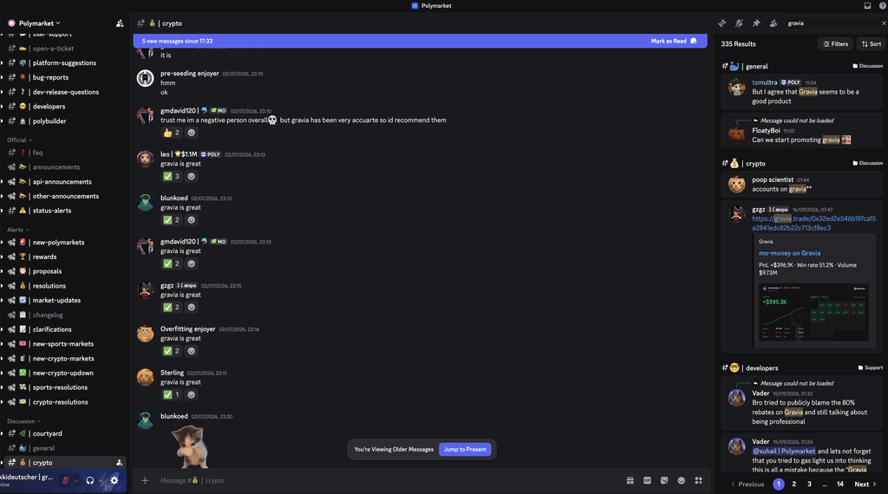
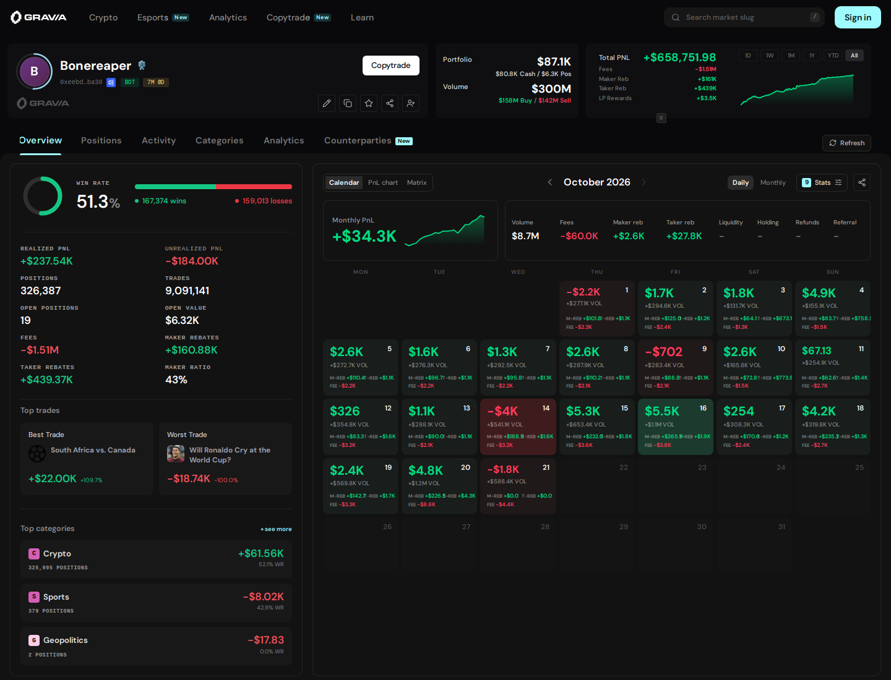
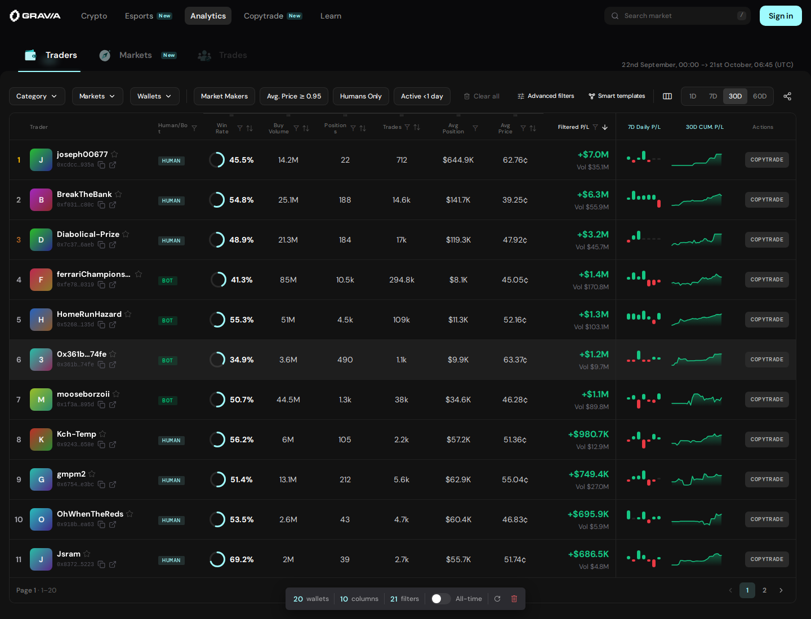

  

<h1 align="center">Gravia</h1>

<strong>Research on the website. Build with the APIs.</strong> Polymarket analytics and live data for market makers and quant traders.

  <a href="https://gravia.trade?via=github"><strong>Explore Gravia</strong></a> ·
  <a href="https://docs.gravia.trade?via=github"><strong>API docs</strong></a> ·
  <a href="https://discord.gg/Gravia"> <strong>Join Discord</strong></a>

**7 of the top 10 crypto bots use Gravia.** Try the public analytics, read the API docs, and inspect the benchmark data before you integrate.

## What the Polymarket community is saying

Members of Polymarket's official Discord are sharing their love for Gravia. See the community feedback below, then **search for "gravia" in Polymarket's official Discord and see the conversations for yourself.**

## See where a wallet's PnL comes from

Go beyond a headline number. Explore daily PnL, positions, category performance, fees, and maker and taker rebates in one view.

**[Explore this wallet live →](https://gravia.trade/0xeebde7a0e019a63e6b476eb425505b7b3e6eba30?via=github)**

## Find the traders worth studying

Filter traders by category, performance, position size, and maker/taker activity. Compare their results and open a wallet to investigate further.

**[Open trader analytics →](https://gravia.trade/analytics?via=github)**

Live product screenshots captured on 21 October 2026.

## Bring the data into your bot

- **PnL and positions:** monitor performance across wallets and categories.
- **Trade-level markouts:** study price moves after your fills and investigate flow toxicity.
- **Counterparty analytics:** understand the wallets and flow you trade against.
- **Live transaction streams:** consume events directly in your algorithms.

**[Browse the API docs →](https://docs.gravia.trade?via=github)**

## Check the timing for yourself

| Gravia feed vs Polymarket RTDS | Median arrival lead | Arrived earlier |
| --- | ---: | ---: |
| Internal mempool | **1,751 ms** | **100%** |
| Internal confirmed | **482 ms** | **96.65%** |

**[Inspect all 1,461 matched transactions →](comparison.csv)**

Two-minute sample on 21 October 2026, measured on a Gravia host in Dublin. Gravia feeds were internal; RTDS was remote. Results exclude Gravia public API and internet delivery overhead and are not a guaranteed customer latency advantage. CSV times are milliseconds since the sample began; positive lead means Gravia arrived earlier.

## Tell us what you're building

Want API access or help finding the right data for your strategy? Come talk to the team.

<a href="https://discord.gg/Gravia"> <strong>Join the Gravia Discord →</strong></a>
