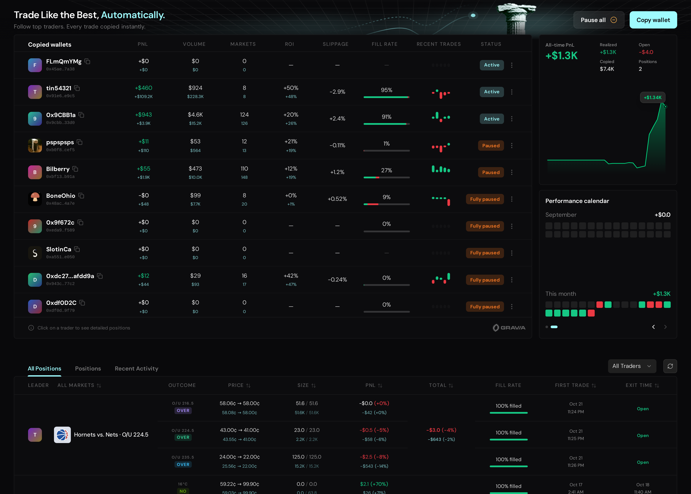
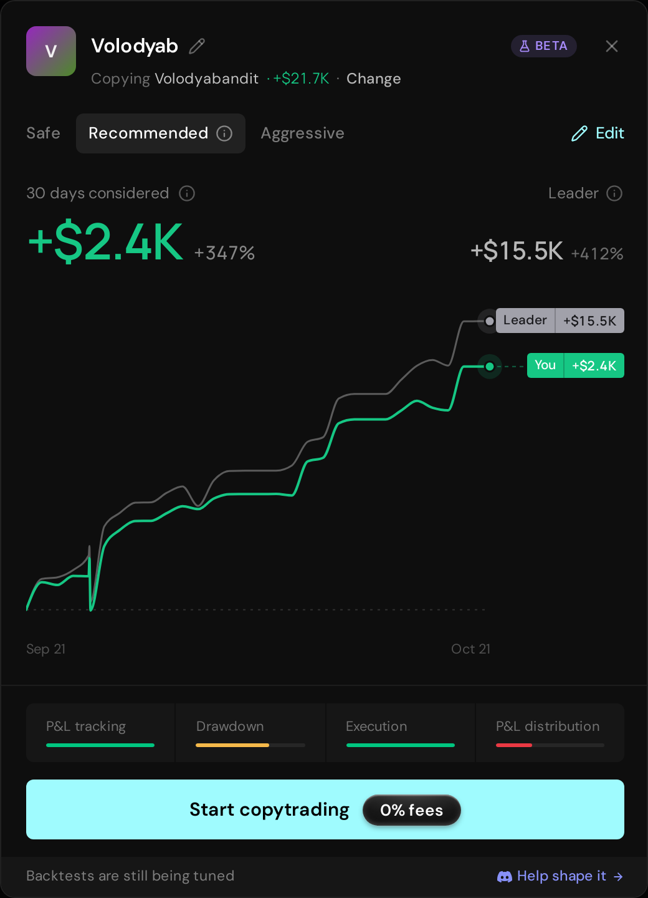

  

<h1 align="center">Gravia</h1>

<strong>Research on the website. Build with the APIs.</strong> Polymarket analytics and live data for market makers and quant traders.

  <a href="https://gravia.trade?via=github"><strong>Explore Gravia</strong></a> ·
  <a href="https://docs.gravia.trade?via=github"><strong>API docs</strong></a> ·
  <a href="https://discord.gg/Gravia"> <strong>Join Discord</strong></a>

**7 of the top 10 crypto bots use Gravia.** Try the public analytics, read the API docs, and inspect the benchmark data before you integrate.

## What the Polymarket community is saying

Members of Polymarket's official Discord are sharing their love for Gravia. See the community feedback below, then **search for "gravia" in Polymarket's official Discord and see the conversations for yourself.**

[View full-resolution screenshot (3326 × 1850) →](https://raw.githubusercontent.com/akkideutscher/gravia-polymarket-analytics/main/assets/polymarket-discord-community.png?v=2)

## See where a wallet's PnL comes from

Go beyond a headline number. Explore daily PnL, positions, category performance, fees, and maker and taker rebates in one view.

**[Explore this wallet live →](https://gravia.trade/0xeebde7a0e019a63e6b476eb425505b7b3e6eba30?via=github)**

## Find the traders worth studying

Filter traders by category, performance, position size, and maker/taker activity. Compare their results and open a wallet to investigate further.

**[Open trader analytics →](https://gravia.trade/analytics?via=github)**

Live product screenshots captured on 21 October 2026.

## Copy the trades, keep control

Found a wallet worth following? Set your sizing, slippage, market filters and stop losses. Gravia copies eligible trades automatically and tracks your PnL, positions and fills.

- **0% copy-trading fees:** Gravia charges nothing to copy trades.
- **Orders sent in as little as 0.22 ms:** fast execution powered by Gravia's own Polygon nodes.
- **3.1M wallets tracked in real time:** compare PnL, win rate, ROI and position sizes before choosing who to follow.
- **24/7 live tracking:** monitor copied-wallet PnL, open positions, fill rate and execution from one dashboard.
- **Copy a specific edge:** filter by market category and price range, such as NBA trades priced at 20–30¢. Adjust your rules or pause at any time.

Dashboard preview using real account data, separate from the wallet example below.

**[Explore copy trading →](https://gravia.trade/copy-trading?via=github)**

### A wallet to explore

[**Volodyabandit**](https://gravia.trade/copy-trading?campaign=234a8a86-73c7-475d-8ca5-402162f58a01&via=github) · Esports / Dota 2

176 markets · +$18.5K PnL · 15.6% ROI · $254.4K volume · 73.9% win rate

Dota-heavy, with a median trade around $133 and larger trades around $700–$1K.

### Backtest before you copy

30-day results: **+$2.94K PnL** · **+2,527% ROI** · **$116 peak capital**

Historical simulation, not a forecast. The live preview below shows a separate backtest.

The backtest modal opened by clicking Copytrade on Volodyabandit’s portfolio. Compare Safe, Recommended and Aggressive presets before copying. This Recommended preview covers 21 Sep–21 Oct 2026 and shows about +$2.4K simulated PnL, separately from the example above.

<a href="https://t.me/+UqCP9E_qd8lhMzk1"> <strong>Join CopyTradingArc →</strong></a>. Our community for interesting wallets, backtests and copy-trading ideas.

## Bring the data into your bot

- **PnL and positions:** monitor performance across wallets and categories.
- **Trade-level markouts:** study price moves after your fills and investigate flow toxicity.
- **Counterparty analytics:** understand the wallets and flow you trade against.
- **Live transaction streams:** consume events directly in your algorithms.

**[Browse the API docs →](https://docs.gravia.trade?via=github)**

## Check the timing for yourself

| Gravia feed vs Polymarket RTDS | Median arrival lead | Arrived earlier |
| --- | ---: | ---: |
| Internal mempool | **1,751 ms** | **100%** |
| Internal confirmed | **482 ms** | **96.65%** |

**[Inspect all 1,461 matched transactions →](comparison.csv)**

Two-minute sample on 21 October 2026, measured on a Gravia host in Dublin. Gravia feeds were internal; RTDS was remote. Results exclude Gravia public API and internet delivery overhead and are not a guaranteed customer latency advantage. CSV times are milliseconds since the sample began; positive lead means Gravia arrived earlier.

## Tell us what you're building

Want API access or help finding the right data for your strategy? Come talk to the team.

<a href="https://discord.gg/Gravia"> <strong>Join the Gravia Discord →</strong></a>
